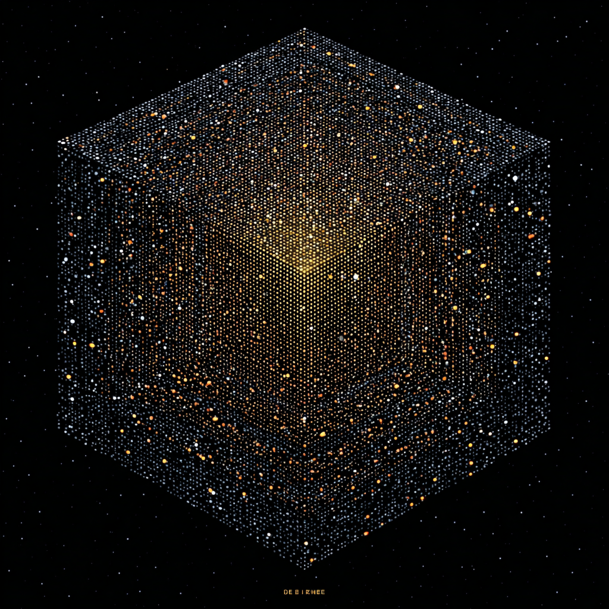

<p align="center">
  
</p>

# VSF (Versatile Serial Format)

A self-describing binary container, and a colour model that says what a picture claims.

Use DNG. Use Protobuf. Write JSON. All of them work, and nothing here asks you to stop. What this repo is: a long stretch of work on making a better option exist, for anyone who wants one. Every value carries its type. Every file carries its hash. Every number is as wide as it needs to be and no wider, with no ceiling. Every colour entry says whether it was measured or guessed. None of that is new on its own. Having all of it in one open format, checked by default, is the point.

**Crate:** `vsf` 0.10.1, format v10, reads v9. **Docs and examples:** https://holdmyoscilloscope.com/vsf/

**In this repository:** [`colour.md`](colour.md), the VSF RGB colourspace · [`idt/`](idt/README.md), Input Device Transforms: the four classes, tiers, and the image field set · [`units.md`](units.md), the base-unit system · [`MEDIA-TYPE.md`](MEDIA-TYPE.md), the media type registrations.

---

## What is built, what is not

Built and published:

- The container: typed values, sections with a table of contents, mandatory BLAKE3 file hash, per-section content hashes, Ed25519 signing, lazy partial reads.
- The colour model: VSF RGB (primaries at 703/523/462 nm, Illuminant E white), four IDT classes with tiers, spectral profiles, 32 source primaries and 37 transfer curves kept byte for byte as they arrived, all held to colour-science 0.4.7 in `tests/encoding_references.rs`.
- Stills, including the DNG round trip in opsin: a DNG converts with its matrices, illuminants and calibration signature kept verbatim, renders bit for bit as the source did, and a characterization made here writes back into a DNG every reader applies.
- Spirix two's-complement floats as first-class types, Dymaxion WorldCoord, Eagle Time, Huffman-compressed Unicode text.

Designed and specified, not yet built:

- Video spans, audio waves, marks, lineage and manifest signatures in the visual container ([`idt/image.md`](idt/image.md)). The still slice is implemented; those are marked *(design)* on the page until the code lands.
- A big-integer path. The wire format allows integers up to 2^35 bits; the Rust readers and writers handle 8 to 128 bits and refuse larger markers rather than misparse them.

---

## Why a new format

Two problems, and no existing format solved both.

**A camera matrix says nothing about itself.** A DNG's ColorMatrix, an ICC input profile and an ACES IDT are each a 3×K matrix fitted to a chart under a light or two. The file does not say whether it was measured on this unit or taken from the maker's datasheet, whether it is a characterization or a look, or what light it was fitted under. A guess reads as a measurement and a look reads as a characterization, by omission. [`idt/README.md`](idt/README.md) is the full argument, including why DNG was not extended and how this differs from ACES.

**Most containers have a ceiling.** TIFF offsets are 32 bits. Protobuf and MessagePack varints stop at 64 bits, and a varint is read byte by byte to find its end. JSON numbers are commonly parsed as 64-bit floats, exact only up to 2^53. Length-prefixed formats have a length field with its own limit. The fix for the second problem is old and simple, and VSF builds on it rather than claiming it.

---

## Exponential Width Encoding

Every integer on the wire is a type letter, one marker byte, then the bytes, big-endian:

```
Value 42:         'u' '3' 0x2A           8 bits
Value 4,096:      'u' '4' 0x10 0x00      16 bits
Value 2^32 - 1:   'u' '5' + 4 bytes      32 bits
Value 2^64 - 1:   'u' '6' + 8 bytes      64 bits
Value 2^128 - 1:  'u' '7' + 16 bytes     128 bits
```

The marker is a base36 digit. `0` to `9` are 0 to 9, `A` to `Z` are 10 to 35. A marker of value N means 2^N bits follow. So `u0` is a bool, `u3` a byte, `u6` a u64, `uA` 1024 bits, and `uZ` 2^35 bits, which is 4 GiB and more than any single integer will need.

What that buys:

0. **O(1) skip.** Read the marker, know the width, move on. No continuation bits, no length-of-length.
1. **No ceiling.** The marker is the exponent. Thirty-six exponents cover bool to 4 GiB with one byte.
2. **Canonical form.** A writer emits the narrowest marker that holds the value, and a reader rejects a value a narrower marker would have held. One number has exactly one byte form, so two byte strings never decode to the same value. That is what makes byte-exact hashing and signatures mean something.
3. **Printable.** Markers are ASCII, so a hex dump reads.

The idea of a width marker before an integer is not new. ASN.1 BER's long-form length is a length-of-length byte, from 1988. CBOR's argument field picks 1, 2, 4 or 8 bytes with a few bits. What VSF does differently is make the marker the exponent directly, hold every width to a power of two, require the minimal form, and use the same scheme for every length, offset and count in the file, so nothing in the format has a size limit the data did not bring.

---

## Type tags

Every value is `⦉letter(s)⦊⦉size⦊⦉data⦊`. The letters say the type. The second byte says which of three things you are looking at, and the ranges never overlap:

| Second byte | ASCII | Meaning |
|---|---|---|
| `0` to `9` | 0x30 to 0x39 | size exponent, base36 low |
| `A` to `Z` | 0x41 to 0x5A | size exponent, base36 high |
| `a` to `z` | 0x61 to 0x7A | named family member |

```
u3  u6  f5  f6  i4  s44  c55     sized primitives
hp  hb  ge  ke  na  nh  wa       family members
d   o   l   x   a   e   w   v    single-letter types
```

`f5`/`f6` are 32- and 64-bit IEEE floats, `j5`/`j6` complex, `s44` a Spirix scalar with a 16-bit fraction and 16-bit exponent, and so on.

### Families

| Prefix | Family | Members |
|---|---|---|
| `h` | Hash | `hp` provenance (BLAKE3 of source bytes) `hb` file hash `hs` `hm` `hg` `hc` `hk`, plus Photon's `hP` `hR` `hI` `hV` |
| `g` | Signature | `ge` Ed25519 `gp` `gd` `gs` `gf` `gr` `gm` `gH` |
| `k` | Key | `ke` Ed25519 `kx` X25519 `kp` `kc` `ka` and more |
| `ks` | Shared secret | `ksx` `ksp` `ksk` `ksf` `ksn` `ksl` `ksh` `ksm` |
| `m` | MAC | `mh` HMAC-SHA256 `mp` Poly1305 `mb` BLAKE3-keyed `mc` CMAC |
| `n` | Network | `na` address `nh` host `ni` IPv4 `nj` IPv6 `nc` CIDR `nm` MAC address `np` port `ns` socket `nu` URL `nn` DNS name |
| `r` | Colour / raster | `re` `ru` `ra` `rf` and the rest; `ro*` are drawable objects |
| `t_` | Tensor, contiguous | one per element type |
| `q_` | Tensor, strided | one per element type |
| `p` | Bit-packed tensor | 1 to 128 bits per element |
| `s`, `c` | Spirix scalar, circle | 25 each, F3 to F7 × E3 to E7 |
| `d` `o` `l` | Dictionary key, offset, length | the container's own structure |
| `a` `x` | ASCII text, Huffman Unicode | |
| `e` `w` | Eagle Time, WorldCoord | |
| `op` | Opcode | executable bytecode |

318 variants in `VsfType` today. The enum is the format: add a variant and the encoder, decoder and `vsfinfo` will not compile until they handle it. The code is Rust, with the usual Rust guarantees and no others; a format parser still has to bound what it allocates against what it was handed, and a bug report is the right response to one that does not.

---

## What the types buy

### Bit-packed tensors

A 14-bit sensor stores 14 bits, not 16. A 4-bit quantised model stores 4. Phred scores store 6.

```rust
let raw = BitPackedTensor::pack(12, vec![4096, 3072], &samples);  // 18 MB, not 24
```

1 to 128 bits per element; 0 is reserved for a future 256-bit width. `BitPackedView` unpacks any rows or tile straight from the bytes without copying the rest, and with the `rayon` feature pack and unpack go parallel with byte-identical output.

### Cryptographic primitives as types

```rust
VsfType::h(HASH_BLAKE3, hash)       // hash, with its algorithm
VsfType::g(SIG_ED25519, signature)  // signature
VsfType::k(KEY_ED25519, pubkey)     // key
VsfType::m(MAC_HMAC_SHA256, tag)    // MAC
```

The algorithm travels in the type, so a SHA-256 hash cannot be handed to code expecting BLAKE3. Implemented today: BLAKE3 hashing (always on), Ed25519 verify (`crypto-verify`, no_std), Ed25519 signing, X25519, ChaCha20-Poly1305 and AES-GCM (`crypto`). Identifiers are reserved for SHA-2, ECDSA, RSA, secp256k1, ML-KEM, FrodoKEM and McEliece so files can name them before the code exists.

### Spirix

Two's-complement floating point, as an alternative to IEEE 754. One zero. One infinity, for actual singularities. Values too small or too large to represent keep their sign instead of collapsing to 0 or ∞. `a × b = 0` iff `a = 0` or `b = 0`, always. Undefined results record why they are undefined. Precision and range chosen independently, F3E3 to F7E7. VSF stores all 25 scalar and 25 circle (complex) types as primitives; the arithmetic is the optional `spirix` crate.

### WorldCoord and Eagle Time

A Dymaxion-projected Earth coordinate, 2.14 mm average and 5.06 mm worst case in 64 bits. Eagle Time is physics-bounded consensus time, optional in the header: a clockless device omits it rather than writing a placeholder.

### Huffman text

`x` is NFC-normalised Unicode under a global frequency table shipped with the crate (`huffman_codes.bin`, BLAKE3-verified at every build). About 36% smaller than UTF-8 on typical text, 83 MB/s encode and over 100 MB/s decode on a 2025 desktop. The table is the wire format: ihi's identity handles derive from it, which is why the 0.6 lane exists (below).

---

## Integrity and provenance

Every file built by `VsfBuilder` carries a BLAKE3 hash of the whole file in its header. There is no opt-out. `verification::read_verified` checks it before handing anything back, on a desktop or in an nRF52840 bootloader with `default-features = false` and `crypto-verify`.

Three layers above that:

0. **Content hashes per section.** `VsfBuilder::content_hashes(true)` gives every table-of-contents entry a BLAKE3 of its body, checked by `Document::content_hash_ok`. A section that is never moved stays provable whatever is appended after it.
1. **Signatures.** `sign_section` signs a hash of the whole document with that section's signature slot zeroed, so it proves the file as built and any later append invalidates it. Manifest signatures, which name sections by content hash so a camera's capture, a lab's thumbnail and an editor's generation each verify on their own, are the next milestone in [`idt/image.md`](idt/image.md).
2. **Calibration hashes.** A RAW names its dark, flat, bias, vignette and distortion frames by hash, so the wrong frame is caught before it corrupts a picture.

BLAKE3 runs at several GB/s per core, faster than the storage the file is going to, so the hash costs nothing you would notice.

---

## Lazy reads

`container::Document` opens any `ByteSource` (a slice, a `Vec`, a `File`) by reading the header alone, then fetches a section's bytes only when asked. `Document::packed` finds a bit-packed plane without copying it, and `packed_rows_u16` reads just the rows a viewer needs. The older parsers in `parse` and `VsfSection::parse` still materialise whole values; use `Document` when that matters.

---

## Quick start

```toml
[dependencies]
vsf = "0.10"
```

```rust
use vsf::{VsfType, BitPackedTensor, Tensor};
use vsf::crypto_algorithms::HASH_BLAKE3;

// 12-bit camera RAW, packed at 12 bits
let raw = BitPackedTensor::pack(12, vec![4096, 3072], &pixel_data);
let encoded = VsfType::p(raw).flatten();

// 8-bit greyscale as a tensor
let img = VsfType::t_u3(Tensor::new(vec![1920, 1080], grey));

// Text, Huffman compressed (needs the `text-encode` feature)
let doc = VsfType::x("Kia ora".to_string());

// A hash that knows its algorithm
let hash = VsfType::h(HASH_BLAKE3, hash_bytes);

// Round trip
let decoded = VsfType::parse(&encoded)?;
assert_eq!(original, decoded);
```

### A minimal RAW

```rust
use vsf::builders::build_raw_image;
use vsf::types::BitPackedTensor;

let samples: Vec<u64> = vec![2048; 4096 * 3072];
let image = BitPackedTensor::pack(12, vec![4096, 3072], &samples);
let bytes = build_raw_image(image, None, None, None)?;   // file hash included
```

The other three arguments are `RawMetadata` (CFA pattern, black and white levels, calibration frame hashes), `CameraSettings` (ISO, shutter, aperture, focal length) and `LensInfo`. See `examples/create_raw_image.rs`.

### Features

| Feature | Enables |
|---|---|
| (default) | `std`, the schema registry, verbose decode errors |
| `derive` | `#[derive(Vsf)]`, one struct definition for both codec halves |
| `text-encode` | `VsfType::x` Huffman text |
| `text` | `vsfinfo` and friends: inspect + text-encode + clap |
| `crypto-verify` | Ed25519 verification only, no_std |
| `crypto` | signing, X25519, ChaCha20-Poly1305, AES-GCM |
| `spirix` | Spirix arithmetic for the `s`/`c` types |
| `rayon` | parallel bit-pack and unpack |
| `logging`, `log-bridge` | the durable VSF log sink, and routing the `log` crate into it |
| `image-tools`, `image-decode` | the `vsfimg` converter, and the decode half on its own |
| `handle` | the `vsf::handle` shim (pulls `ihi`) |

Embedded builds use `default-features = false`; everything that needs an allocator or atomics is behind a feature.

### Binaries

- `vsfinfo`: a 1:1 literal dump of any VSF file (`--features text`).
- `vsflog`: read a `.log.vsf` structured log, with level and grep filters and `-f`.
- `vsfimg`: any PNG, JPEG, WebP or TIFF to a canonical VSF image, ICC honoured.

---

## Parsing

Two tiers. `VsfSection::parse` is schema-agnostic: it returns a section's name and raw fields, no validation, caller holds the pointer. `SectionBuilder::parse` takes a `SectionSchema`, validates the section name and each field's type, and returns a builder you can modify and re-encode:

```rust
use vsf::schema::{SectionSchema, SectionBuilder, TypeConstraint};

let schema = SectionSchema::new("camera")
    .field("iso", TypeConstraint::AnyUnsigned)
    .field("shutter", TypeConstraint::AnyFloat)
    .field("model", TypeConstraint::AnyString);

let builder = SectionBuilder::parse(schema, &section_bytes)?;
builder.set("iso", 1600u32)?;
let bytes = builder.encode()?;
```

Both parse the same `[d"name"(d"field":value)...]` bytes. Official schemas (image, camera, audio, network_peer, announce) and examples are in [`src/schema/README.md`](src/schema/README.md). Section names take dots (`camera.sensor`).

File I/O is out of scope on purpose. The crate gives you bytes; a file, a socket, an mmap or a database blob is your decision.

---

## Versioning

From 0.8.0 the crate minor is the format version: vsf 0.10.x writes v10 files. Any breaking change, wire or API, bumps both. The backward-compatibility floor lives in every file header and is enforced by the reader by name ("file is v7, this build reads v9+"), never by misparsing.

The 0.6 lane (`0.6.42`) is the frozen encoder for [ihi](https://crates.io/crates/ihi): byte-identical to 0.8.0, published so the identity-critical `x` encoder can never move under handle-proof derivation. Do not pin `"0.6"` unless you are ihi. It changes only for coordinated encoder emergencies.

Yank policy: a release that wrote wrong bytes is yanked (0.4.0, 0.4.1). A release that misread valid files but never wrote a bad byte is superseded and left in history (0.4.2, 0.5.0). `tests/frozen_wire.rs` pins the exact bytes of `x`, `a` and `d` so a wire break can never ship silently again. Full history in [`CHANGELOG.md`](CHANGELOG.md).

---

## The rest of the stack

VSF is the encoding the rest of it serialises thru: Spirix (arithmetic), TOKEN (identity), Eagle Time (time), Dymaxion (location), ihi, tohu, manifestus and Photon. The vocabulary those layers share is defined once, in `GLOSSARY.md` in the ferros repo.

---

## Contributing

Active development. The core encoding and decoding are stable and pinned by tests. Issues and pull requests are open; the name on the commits is whoever wrote them.

---

## License

Three things, three licenses:

- **Code** (this crate, `vsf-derive`, the tools): [Mozilla Public License 2.0](LICENSE). Use it anywhere, including in closed products and in hardware. Change a file from this repo and ship it, and that file's source ships too. That is the whole obligation, and it is what keeps the format from ever going closed: every improvement to the encoding comes back out. MPL carries its own patent grant from every contributor.
- **Specification** (`MEDIA-TYPE.md`, `colour.md`, `units.md`, `idt/`): [CC BY 4.0](https://creativecommons.org/licenses/by/4.0/). Implement it in any language, under any license, for any purpose. It is published, dated and public so that nobody can patent it out from under anyone.
- **Name**: [TRADEMARK.md](TRADEMARK.md). "VSF" means files that open in every VSF reader. Conforming implementations may call themselves VSF. A fork that changes the wire is a different format and picks a different name.

Nobody is asked for money, attribution beyond what MPL requires, or permission. Sell what you build with it. The format itself stays free, for everyone, forever, and the licenses above are the mechanism, not a request.
